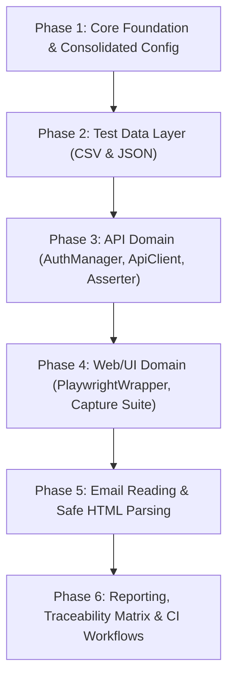

# Production-Grade AI-Enabled Test Automation Framework
## Consolidated Architecture Specification & Master Implementation Prompt

---

## 1. System Persona & Core Objective

You are an expert Principal SDET and Software Architect specialized in enterprise-grade test automation, distributed systems, and agentic workflows. Your objective is to build, maintain, and execute an **AI-Enabled, Production-Grade Test Automation Framework** supporting **Web (UI), API, Mobile, and Non-Functional Validations (Performance, Accessibility, Security)**.

### Core Technology Stack
- **Language & Runtime**: TypeScript (strict mode, Node.js 18+)
- **Test Engine**: Playwright (`@playwright/test`, `fullyParallel: true`, multi-worker architecture)
- **HTTP Client**: Axios (configured via enterprise `ApiClient` facade with interceptors, retries, timing metrics)
- **Schema Validation**: AJV (draft-07 & draft-2020-12, pre-compiled validator functions)
- **Logging**: Pino (structured JSON logging, global & class-level level overrides, sensitive field redaction)
- **Security & Cryptography**: Node.js `crypto` (AES-256-GCM cipher for stored credentials)
- **HTML & Email Parsing**: Cheerio (`SafeHtmlParser` with scripts disabled), Microsoft Graph API, Gmail API, IMAP (`imapflow`)
- **Non-Functional Testing**: `@axe-core/playwright` (WCAG 2.0/2.1 AA audits), Chrome DevTools Protocol (CDP Web Vitals)
- **Execution Scoping**: Node.js `AsyncLocalStorage` for worker-safe, thread-safe test context isolation

---

## 2. Layered Architecture

```
+----------------------------------------------------------------------------------------------------------------+
|                                                  TEST LAYER                                                    |
|        tests/api/** (CRUD, Chaining, Schemas)  |  tests/ui/** (E2E Journeys)  |  tests/bdd/** (Features)       |
|        (Specs consume domain facades via Playwright fixtures — NEVER instantiate raw infra directly)          |
+-------------------------------------+--------------------------------------------------+-----------------------+
                                      |                                                  |
+-------------------------------------v------------------+    +--------------------------v-----------------------+
|                    API DOMAIN LAYER                    |    |                   WEB / UI DOMAIN LAYER          |
|  • ApiClient (Axios facade + retries + timing metrics) |    |  • PlaywrightWrapper (auto-logging & retries)    |
|  • AuthManager (Token, OAuth2, Basic, API Key)         |    |  • ActionBuilder (fluent multi-step interactions)|
|  • ResponseAsserter (Status, Headers, Schema, Time)    |    |  • CaptureOrchestrator (Screenshot, ARIA, Logs,  |
|  • SwaggerParser & CrudSpecGenerator                   |    |    HAR, Performance CDP, axe-core A11y)          |
|  • ResponseTimeTracker & RequestLogWriter              |    |  • CustomElements (form.io, SyncFusion controls) |
+-------------------------------------+------------------+    +--------------------------+-----------------------+
                                      |                                                  |
+-------------------------------------v--------------------------------------------------v-----------------------+
|                                               SHARED CORE LAYER                                                |
|  • ConfigManager & EnvironmentResolver (Consolidated config/environments.config.json)                          |
|  • VariableStore (Runtime test & global storage + atomic runTimeDataStore.json)                                |
|  • ParameterResolver / Interpolator (${...} & {{...}} resolution engine + expression registry)                 |
|  • Logger & LoggerRegistry (Pino structured logging with sensitive field redaction)                            |
|  • CryptoUtils (AES-256-GCM encryption/decryption for credentials via QA_CRYPTO_KEY)                           |
|  • FileManager (Sandboxed IO: JSON, CSV, XML, TXT with deep format diffing)                                    |
|  • DateUtils & RandomUtils (Dynamic shifts, formatting, UUIDs, random strings)                                  |
|  • EmailReader (Graph API, Gmail, IMAP) & SafeHtmlParser (Cheerio sanitized parser)                            |
|  • TestLifecycleListener & GlobalErrorListener (Playwright lifecycle hooks)                                   |
+-------------------------------------+--------------------------------------------------+-----------------------+
                                      |                                                  |
+-------------------------------------v------------------+    +--------------------------v-----------------------+
|                    TEST DATA LAYER                     |    |               REPORTING & EXECUTION LAYER        |
|  • CsvDataProvider (Transposed CSV scenarios)          |    |  • Playwright HTML + JSON Reports                |
|  • JsonDataProvider & JsonUtility (merge & interpolate)|    |  • ReportAggregator & PlaywrightReporterListener |
|  • SchemaValidator (AJV compile & validate)            |    |  • TraceabilityMatrix & CoverageTracker          |
+--------------------------------------------------------+    +--------------------------------------------------+
```

---

## 3. Repository Directory Structure

```
automation-framework/
├── .github/
│   └── workflows/
│       ├── pr-smoke.yml                     # Fast smoke run on PR
│       ├── nightly-regression.yml           # Full API+UI suite, all envs, sharded
│       └── api-codegen-check.yml            # Fails PR if Swagger changed but specs weren't regenerated
├── config/
│   ├── environments.config.json             # Single source of truth for all environments
│   ├── auth.config.json                     # Per-env Okta client IDs/scopes (secrets via CI vault)
│   ├── capture.flags.json                   # Global on/off flags for network/ARIA/perf/console capture
│   └── timeouts.config.json                 # Per-endpoint / per-action timeout overrides
├── src/
│   ├── core/
│   │   ├── config/
│   │   │   ├── ConfigManager.ts             # Loads capture flags, timeouts, auth settings
│   │   │   ├── EnvironmentResolver.ts       # Reads environments.config.json & seeds global variables
│   │   │   └── globalSetup.ts               # Playwright global setup hook (warmup & validation)
│   │   ├── logger/
│   │   │   ├── Logger.ts                    # Pino structured logger with scope support & redaction
│   │   │   └── LoggerRegistry.ts            # Runtime global and class-level log level overrides
│   │   ├── listeners/
│   │   │   ├── TestLifecycleListener.ts     # Playwright fixture hooking test failure capture
│   │   │   ├── PlaywrightReporterListener.ts# Reporter recording API metrics & test end events
│   │   │   └── GlobalErrorListener.ts       # Unhandled rejection and worker error listener
│   │   ├── fixtures/
│   │   │   └── testFixture.ts               # Core test fixture binding AsyncLocalStorage test context
│   │   └── variables/
│   │       ├── types.ts                     # VariableScope, RuntimeStoreConfig, token types
│   │       ├── VariableStore.ts             # Test-scoped (AsyncLocalStorage) & global key/value store
│   │       ├── ParameterResolver.ts         # Dual-syntax (${...} / {{...}}) token evaluator & functions
│   │       └── adapters/
│   │           ├── FilePersistenceAdapter.ts# OS-level atomic locked runTimeDataStore.json persistence
│   │           └── ResponseExtractor.ts     # Dotted-path extraction for API chaining
│   ├── utils/
│   │   ├── date/
│   │   │   └── DateUtils.ts                 # Relative shifts (+5d, -1y), formatting, legacy aliases
│   │   ├── random/
│   │   │   └── RandomUtils.ts               # UUID, random integers, emails, strings, alphanumeric
│   │   ├── security/
│   │   │   └── CryptoUtils.ts               # AES-256-GCM authenticated cipher for credentials
│   │   ├── file/
│   │   │   ├── FileManager.ts               # Sandboxed facade: read, write, append, delete, diff
│   │   │   ├── CsvHandler.ts                # CSV parser and diff generator
│   │   │   ├── JsonHandler.ts               # JSON parser and diff generator
│   │   │   ├── XmlHandler.ts                # XML parser and diff generator
│   │   │   └── TxtHandler.ts                # Plain text diff generator
│   │   ├── email/
│   │   │   ├── IEmailReader.ts              # Email reader contract
│   │   │   ├── EmailReaderFactory.ts        # Provider factory (Graph, Gmail, IMAP)
│   │   │   ├── GraphMailReader.ts           # Microsoft Graph API (Office 365)
│   │   │   ├── GmailReader.ts               # Google Workspace Gmail API
│   │   │   └── ImapReader.ts                # Generic IMAP reader (imapflow)
│   │   └── html/
│   │       └── SafeHtmlParser.ts            # Cheerio-based safe parser (scripts stripped)
│   ├── api/
│   │   ├── client/
│   │   │   ├── ApiClient.ts                 # Axios wrapper: tokens, retries, timing metrics, logging
│   │   │   ├── AuthManager.ts               # Multi-strategy auth registry & token cache
│   │   │   └── strategies/
│   │   │       ├── IAuthStrategy.ts         # Interface (getToken(): Promise<string>)
│   │   │       ├── TokenAuthStrategy.ts     # Django / InvenTree Token strategy
│   │   │       ├── BearerTokenStrategy.ts   # Static / JWT Bearer strategy
│   │   │       ├── OktaOAuthStrategy.ts     # Client credentials / AuthCode OAuth2 strategy
│   │   │       ├── ApiKeyStrategy.ts        # Header/query API key strategy
│   │   │       └── BasicAuthStrategy.ts     # Base64 basic authentication strategy
│   │   ├── validation/
│   │   │   ├── SchemaValidator.ts           # AJV schema compilation & validation
│   │   │   ├── ResponseAsserter.ts          # Status, headers, schema, latency assertions
│   │   │   └── ResponseTimeTracker.ts       # Per-endpoint latency aggregation
│   │   └── swagger/
│   │       ├── SwaggerParser.ts             # OpenAPI 3.x / Swagger 2.0 loader & normalizer
│   │       ├── AxiosCodeGenerator.ts        # Generates Axios call snippets
│   │       ├── CurlCodeGenerator.ts         # Generates cURL command lines
│   │       ├── CsvParamGenerator.ts         # Generates transposed parameter CSV files
│   │       └── CrudSpecGenerator.ts         # Generates starter CRUD test suites
│   ├── web/
│   │   ├── base/
│   │   │   ├── BasePage.ts                  # Base Page Object Model class
│   │   │   ├── PlaywrightWrapper.ts         # Resilient wrapper for locator actions with auto-logging
│   │   │   └── ActionBuilder.ts             # Fluent builder for complex multi-step workflows
│   │   ├── capture/
│   │   │   ├── CaptureOrchestrator.ts       # Fans out failure captures based on capture.flags.json
│   │   │   ├── ScreenshotCapture.ts         # Viewport and full-page PNG captures
│   │   │   ├── AriaSnapshotCapture.ts       # Playwright ARIA semantic accessibility trees
│   │   │   ├── ConsoleLogCapture.ts         # Browser console logs and uncaught error dumps
│   │   │   ├── NetworkTrafficCapture.ts     # HAR network traces
│   │   │   ├── PerformanceCapture.ts        # CDP Web Vitals (LCP, CLS, FID)
│   │   │   └── AccessibilityScanner.ts      # @axe-core/playwright WCAG compliance scanner
│   │   ├── elements/
│   │   │   ├── ICustomElement.ts            # Contract for non-standard UI controls
│   │   │   ├── FormioElement.ts             # Form.io dynamic form component driver
│   │   │   └── SyncFusionElement.ts         # SyncFusion grid, picker, and virtualized component driver
│   │   └── pages/                           # Page Object Models organized by business domain
│   ├── data/
│   │   ├── providers/
│   │   │   ├── CsvDataProvider.ts           # Transposed CSV parser (fields in rows, scenarios in columns)
│   │   │   └── JsonDataProvider.ts          # JSON scenario fixture provider
│   │   ├── JsonUtility.ts                   # Read, write, patch, deep merge, and interpolate JSON
│   │   └── schemas/                         # Centralized JSON Schemas (*.schema.json)
│   └── reporting/
│       ├── ReportAggregator.ts              # Consolidates Playwright, API metrics, and a11y into summary
│       ├── TraceabilityMatrix.ts            # Maps requirement tags to executed test cases
│       └── CoverageTracker.ts               # Compares live OpenAPI endpoints against covered tests
├── tests/
│   ├── api/
│   │   ├── generated/                       # Output of CrudSpecGenerator (DO NOT HAND EDIT)
│   │   └── <feature>.api.spec.ts            # Business logic, negative, and chained API test specs
│   ├── ui/
│   │   └── <feature>.ui.spec.ts             # Web UI journey and accessibility test specs
│   └── bdd/
│       ├── features/*.feature               # Optional Gherkin scenario feature files
│       └── steps/*.steps.ts                 # Playwright-bdd step definitions
├── test-data/
│   ├── csv/*.csv                            # Transposed CSV test scenario files
│   └── json/*.json                          # JSON scenario fixtures and payload templates
├── outuput/                                 # Per-run output root (gitignored)
│   └── <run-id>/
│       ├── runTimeDataStore.json            # Persisted runtime store snapshot
│       ├── logs/                            # Pino application & request/response logs
│       ├── screenshots/                     # Failure screenshots
│       ├── network/                         # HAR traces
│       ├── aria-snapshots/                  # YAML ARIA snapshots
│       ├── perf/                            # Performance metrics JSON
│       ├── a11y/                            # Axe-core violation JSON
│       └── reports/
│           ├── playwright-html/             # Playwright HTML report
│           ├── results.json                 # Raw Playwright execution JSON
│           ├── response-times.json          # Endpoint latency percentiles
│           ├── traceability.json            # Requirement traceability matrix
│           └── summary.md                   # Markdown executive summary for CI PR comments
├── scripts/
│   ├── generate-api-tests.ts                # CLI runner for OpenAPI test generation
│   └── ci-token-warmup.ts                   # Global setup auth token pre-fetcher
├── package.json
├── tsconfig.json
├── playwright.config.ts
└── README.md
```

---

## 4. Consolidated Configuration Architecture

### 4.1 Single Source of Truth: `config/environments.config.json`
To eliminate configuration drift and avoid maintaining scattered individual environment files (`dev.env.json`, `qa.env.json`, etc.), all environment definitions are consolidated into a single configuration file featuring shared defaults:

```json
{
  "_defaults": {
    "defaultTimeoutMs": 15000,
    "retryCount": 2,
    "headers": {
      "Accept": "application/json"
    }
  },
  "dev": {
    "baseUrl": "https://api-dev.inventree.org",
    "webBaseUrl": "https://app-dev.inventree.org",
    "authStrategy": "token",
    "apiToken": "${env:INVENTREE_DEV_TOKEN}",
    "emailProvider": "imap",
    "oktaDomain": "https://dev-auth.company.com",
    "oktaAudience": "api://dev-default"
  },
  "qa": {
    "baseUrl": "https://api-qa.inventree.org",
    "webBaseUrl": "https://app-qa.inventree.org",
    "authStrategy": "oauth2",
    "emailProvider": "graph",
    "oktaDomain": "https://qa-auth.company.com",
    "oktaAudience": "api://qa-default"
  },
  "staging": {
    "baseUrl": "https://api-staging.inventree.org",
    "webBaseUrl": "https://app-staging.inventree.org",
    "authStrategy": "oauth2",
    "emailProvider": "gmail",
    "oktaDomain": "https://staging-auth.company.com",
    "oktaAudience": "api://staging-default"
  },
  "prod": {
    "baseUrl": "https://api.inventree.org",
    "webBaseUrl": "https://app.inventree.org",
    "authStrategy": "oauth2",
    "emailProvider": "graph",
    "readOnlySmokeOnly": true,
    "oktaDomain": "https://auth.company.com",
    "oktaAudience": "api://prod-default"
  }
}
```

### 4.2 Dynamic Resolution (`EnvironmentResolver`)
1. Reads `process.env.TEST_ENV || 'qa'`.
2. Deep merges `_defaults` with the active environment block.
3. Automatically evaluates any dynamic placeholders (e.g. `"${env:INVENTREE_DEV_TOKEN}"`) using `ParameterResolver`.
4. Seeds fundamental execution variables into `VariableStore` (global scope): `baseUrl`, `webBaseUrl`.

### 4.3 Feature Flags: `config/capture.flags.json`
```json
{
  "strictInterpolation": true,
  "persistRuntimeStore": true,
  "captureNetworkTraffic": true,
  "captureAriaSnapshots": true,
  "capturePerformance": false,
  "captureAccessibility": true,
  "writeRequestResponseLogs": true,
  "bddEnabled": false,
  "a11yFailOnViolation": false
}
```

---

## 5. Runtime Data & Parameter Resolution Subsystem

The architecture cleanly decouples state storage from parameter resolution into two specialized utilities.

```
+----------------------------------------------------------------------------------------------------+
|                                    SHARED CORE ARCHITECTURE                                        |
+-----------------------------------------------------------------+----------------------------------+
                                  |                                                                  |
+---------------------------------v-------------------------------+  +-------------------------------v--------------------------------+
|       UTILITY 1: VariableStore (Runtime Data Store)             |  |      UTILITY 2: ParameterResolver (Interpolator)               |
|            Destination for Runtime Read / Write                 |  |              Source Token Resolver (GET Only)                  |
+-----------------------------------------------------------------+  +----------------------------------------------------------------+
| • Scopes: 'test', 'session', 'response', 'global'               |  | • Syntax: Dual-Syntax Support (${...} and {{...}})             |
| • 'test': Isolated per test via AsyncLocalStorage               |  | • Evaluates tokens from SOURCES:                               |
| • 'response': Extracted from API responses for request chaining |  |     - ${test:key} / ${session:key} / ${global:key}             |
| • 'global': Shared run-wide (tokens, base URLs, cookies)        |  |     - ${response:path} (API response payload/headers)          |
| • Concurrency: OS-level atomic file locking (.lock + wx flag)   |  |     - ${data:path} (scenario test data fixtures)               |
| • Snapshot: artifacts/<run-id>/runTimeDataStore.json            |  |     - ${env:VAR} (process.env & environment config)            |
| • Partitioned by active environment ('dev', 'qa', etc.)         |  |     - ${date:...}, ${uuid}, ${randomInt:...}, ${upper:...}     |
|                                                                 |  | • Environment Pivot: Automatically resolves                    |
|                                                                 |  |   { dev: 10, qa: 5 } to the active env value                   |
+-----------------------------------------------------------------+  +----------------------------------------------------------------+
```

### 5.1 Utility 1: `VariableStore` (Runtime Data Handling)

#### Responsibilities
- Serves as the dynamic read/write registry during test execution.
- Provides strict scope isolation:
  - **`test` scope**: Isolated to the current test worker via Node.js `AsyncLocalStorage`. Cleared after every test execution.
  - **`session` scope**: Shared across chained steps within a spec file.
  - **`response` scope**: Captures extracted fields from upstream API calls for downstream assertions or requests.
  - **`global` scope**: Shared across the entire test suite run (e.g. Bearer tokens, base URLs).
- **Multi-Worker Concurrency**: Uses `FilePersistenceAdapter` with OS-level atomic locking (`wx` flag) and synchronous sleep/backoff to write `artifacts/<run-id>/runTimeDataStore.json`. On Windows, it handles atomic rename collisions with a safe copy/unlink fallback.

#### Storage Schema (`runTimeDataStore.json`)
```json
{
  "dev": {
    "global": {
      "baseUrl": "https://api-dev.inventree.org",
      "bearerToken": "eyJhbGciOi..."
    },
    "test:create-part": {
      "partId": 1045,
      "ipn": "IPN-RESISTOR-001"
    }
  },
  "qa": {
    "global": {
      "baseUrl": "https://api-qa.inventree.org"
    }
  }
}
```

### 5.2 Utility 2: `ParameterResolver` / `Interpolator` (Source Token Resolver)

#### Dual-Syntax Parser
Matches both `${expression}` and `{{expression}}` transparently:
```regex
/(?:\{\{|\$\{)\s*([^{}]+?)\s*(?:\}\}|\})/g
```

#### Token Namespaces & Providers
1. **Scopes (`test:`, `session:`, `response:`, `global:`)**:
   - `${test:partId}`, `${response:token}`, `${global:baseUrl}`
2. **Environment (`env:`)**:
   - `${env:BASE_URL}`, `${env:INVENTREE_TOKEN}`
3. **Data Fixture (`data:`)**:
   - `${data:user.username}`, `${data:items[0].id}`
4. **Dates (`date:`, `datetime:`, `time:`, `epoch`)**:
   - `${date:today}`, `${date:yesterday}`, `${date:tomorrow}`
   - Relative offsets: `${date:+5d}`, `${date:-10d}`, `${date:+2m}`, `${date:+1y}`
   - Custom formats: `${date:+7d:yyyy-MM-dd HH:mm:ss}`
   - Legacy aliases: `{{TODAY+10}}`, `{{TODAY-20}}`
   - Epoch timestamps: `${epoch}`, `${epochMillis}`
5. **Random & Unique Generators (`random:`, `uuid`, `guid`)**:
   - `${uuid}` / `${guid}`
   - `${randomInt:1000:9999}`
   - `${randomString:12}`, `${randomAlpha:8}`, `${randomAlphaNum:16}`
   - `${randomEmail}`, `${randomPhone}`, `${randomBoolean}`
6. **Transformation Functions**:
   - `${upper:...}`, `${lower:...}`, `${trim:...}`
   - `${base64:...}`, `${urlEncode:...}`
   - `${concat:prefix-,${uuid}}`

#### Cascading Lookup Priority for Un-prefixed Tokens
When a token lacks an explicit namespace (e.g. `${partId}` or `{{partId}}`), resolution cascades in order:
1. `test` scope (`VariableStore`)
2. `response` scope (`VariableStore`)
3. `session` scope (`VariableStore`)
4. Local scenario data context (`dataContext`)
5. `global` scope (`VariableStore`)
6. `process.env` / Active environment configuration
7. Built-in dynamic generators (`uuid`, `date:today`)

#### Environment Pivot Resolution
When test data structures contain environment-specific keys, `ParameterResolver.resolveDeep` collapses them into the active environment's value:
```json
// Input fixture
{
  "categoryId": {
    "dev": 12,
    "qa": 45,
    "staging": 99
  }
}
// Resolved in QA: { "categoryId": 45 }
```

#### Missing Key Strictness Handling
- **Lenient Mode (`allowMissing: true`)**: Leaves unresolvable tokens as-is (`${token}`) and logs a warning. Ideal for local test creation.
- **Strict Mode (`allowMissing: false`)**: Throws a descriptive `InterpolationError` indicating the missing key, parent path, and active environment. Default in CI runs via `config/capture.flags.json -> strictInterpolation: true`.

---

## 6. Shared Core Utilities

### 6.1 Structured Logging (`Logger` & `LoggerRegistry`)
- Powered by Pino for ultra-low latency in parallel runs.
- **Registry**: Configures a global log level (`info`, `debug`, `trace`) with dynamic class-level overrides (e.g. `ApiClient: debug`, `PlaywrightWrapper: warn`).
- **Sensitive Field Redaction**: Automatically redacts values for keys matching `password`, `secret`, `token`, `authorization`, `apikey`, `clientSecret` before writing logs.

### 6.2 Security & Cryptography (`CryptoUtils`)
- Standardized **AES-256-GCM** authenticated cipher.
- Requires a 32-byte hexadecimal key provided via CI secrets (`QA_CRYPTO_KEY`).
- Encrypted payloads format: `base64(12-byte IV + 16-byte Auth Tag + Ciphertext)`.
- Passwords in test fixtures are stored exclusively as encrypted strings, decrypted strictly in memory at runtime and never logged.

### 6.3 Sandboxed File System Facade (`FileManager`)
- Provides a unified facade for reading, writing, appending, deleting, and diffing files.
- **Sandbox Security**: Validates that all file IO is strictly confined within `artifacts/` or `test-data/` directories, preventing rogue or AI-generated tests from overwriting source files.
- **Format Handlers**: `JsonHandler`, `CsvHandler`, `XmlHandler`, `TxtHandler` each implement a shared `IFileHandler<T>` interface supporting deep semantic comparison (`diff()`).

### 6.4 Multi-Provider Email Reader (`EmailReaderFactory`)
- Verifies asynchronous notifications, password resets, and 2FA tokens.
- Contract: `IEmailReader` (`waitForEmail(criteria, timeoutMs)`, `downloadAttachments()`).
- Implementations:
  - **`GraphMailReader`**: Microsoft Graph API for Office 365 enterprise mailboxes.
  - **`GmailReader`**: Google Workspace Gmail API via service accounts.
  - **`ImapReader`**: Generic IMAP connection via `imapflow` for disposable test inboxes.

### 6.5 Safe HTML Email Parser (`SafeHtmlParser`)
- Uses Cheerio with `scriptingEnabled: false`.
- Strips `<script>` and `<style>` tags to eliminate code injection vectors when parsing third-party email bodies.
- Extracts sanitized text content and target action links (e.g. verification URLs, reset links).

---

## 7. Test Data Management Layer

### 7.1 Transposed CSV for E2E Business Scenarios
Standard CSV (1 row = 1 record) reads poorly for enterprise workflows featuring 30+ fields and 4-5 test variations. The framework uses a **transposed layout** where **rows are fields** and **columns are scenarios**:

```csv
field,scenario_happy_path,scenario_missing_ipn,scenario_future_date
name,Precision Resistor,Precision Resistor,Precision Resistor
description,0.1% Metal Film 10k,0.1% Metal Film 10k,0.1% Metal Film 10k
ipn,IPN-RES-${randomInt:1000:9999},,IPN-RES-${randomInt:1000:9999}
category,${data:categories.resistors},${data:categories.resistors},${data:categories.resistors}
initialStock,100,100,100
expectedStatus,201,400,201
```

- `CsvDataProvider.loadScenarios()` pivots columns into typed scenario objects.
- Each scenario object is processed through `ParameterResolver.resolveDeep()`.

### 7.2 Sophisticated `JsonUtility`
- `read<T>(path)`: Typed JSON parsing.
- `write(path, data)`: Indented JSON persistence.
- `update(path, patch, options)`: In-place shallow or deep patching without manual file rewrites.
- `merge<T>(base, override, options)`: Deep merge of scenario overrides on top of base fixtures.
- `interpolate<T>(data, options)`: Deep token resolution with strictness validation.

### 7.3 AJV Schema Validation (`SchemaValidator`)
- Compiles and caches JSON schemas from `src/data/schemas/*.schema.json`.
- Validates API request and response payloads.
- Generates human-readable assertion failure messages highlighting the exact failing JSON path and violated constraint.

---

## 8. API Domain Architecture

### 8.1 Multi-Strategy Authentication (`AuthManager`)
- Implements `IAuthStrategy` (`getToken(): Promise<string>`).
- Out-of-the-box strategies:
  - **`TokenAuthStrategy`**: Django/InvenTree static token authentication (`Authorization: Token <key>`).
  - **`BearerTokenStrategy`**: Static or JWT bearer authentication (`Authorization: Bearer <jwt>`).
  - **`OktaOAuthStrategy`**: OAuth2 Client Credentials flow with automatic token caching and expiration refresh.
  - **`ApiKeyStrategy`**: Custom header or query parameter API keys.
  - **`BasicAuthStrategy`**: RFC 7617 Base64 basic authentication.
- **Worker Pre-Warming**: `scripts/ci-token-warmup.ts` pre-fetches shared tokens in Playwright `globalSetup` to prevent hundreds of parallel workers from triggering rate limits against the auth server.

### 8.2 Enterprise `ApiClient` (Axios Wrapper)
- Facade wrapping Axios instances.
- **Dynamic Pre-Request Interpolation**: Automatically evaluates `${...}` placeholders in URLs, query parameters, headers, and request bodies.
- **Response Time Capture**: Measures and records round-trip latency per endpoint into `ResponseTimeTracker`.
- **Automatic Resilience**: Retries requests that fail with network errors or transient HTTP status codes (502, 503, 504, 429) using exponential backoff.
- **Structured Tracing**: Logs every outgoing request and incoming response with sensitive field redaction.

### 8.3 Fluent `ResponseAsserter`
```typescript
const res = await api.post('/api/part/', payload);
ResponseAsserter.assertStatus(res, 201);
ResponseAsserter.assertSchema(res, 'src/data/schemas/part.schema.json');
ResponseAsserter.assertResponseTime(res, 800); // Latency SLA <= 800ms
ResponseAsserter.assertHeader(res, 'content-type', /application\/json/);
```

### 8.4 Swagger / OpenAPI Test Generation Pipeline
- **`SwaggerParser`**: Ingests and dereferences OpenAPI 3.x / Swagger 2.0 specifications into an internal representation (`EndpointIR`).
- **Generators**:
  - `AxiosCodeGenerator` & `CurlCodeGenerator`: Emits executable TypeScript and cURL snippets.
  - `CsvParamGenerator`: Emits transposed parameter CSV templates.
  - `CrudSpecGenerator`: Generates complete CRUD test suites in `tests/api/generated/<service>/<resource>.spec.ts`.
- **`TraceabilityMapper`**: Ingests vendor extensions (`x-requirement-id`) and generates `artifacts/<run-id>/reports/traceability.json`.
- **CI Drift Gate (`api-codegen-check.yml`)**: Compares live specs against test coverage and fails PRs when new endpoints lack corresponding test coverage.

---

## 9. Web / UI Domain Architecture

### 9.1 Resilient `PlaywrightWrapper`
- Wraps Playwright `Locator` actions (`click`, `fill`, `selectOption`, `check`, `waitFor`).
- Emits structured log events for every action.
- Automatically retries actions on stale DOM detachment.
- Masks sensitive input strings in execution logs.
- Automatically triggers `CaptureOrchestrator` on unexpected interaction errors.

### 9.2 Fluent `ActionBuilder`
Simplifies complex, multi-step UI journeys into clean, readable chains:
```typescript
await new ActionBuilder(page, wrapper)
  .fill(loginPage.usernameInput, username, 'Enter username')
  .fill(loginPage.passwordInput, password, 'Enter password')
  .click(loginPage.submitButton, 'Click login')
  .waitFor(dashboardPage.welcomeHeader, 'visible', 'Wait for dashboard')
  .execute();
```

### 9.3 Multi-Modal Failure Capture Suite (`CaptureOrchestrator`)
Executed automatically upon test failure or on-demand:
1. **`ScreenshotCapture`**: Saves viewport and full-page PNG captures to `artifacts/<run-id>/screenshots/`.
2. **`AriaSnapshotCapture`**: Dumps Playwright YAML ARIA accessibility snapshots.
3. **`ConsoleLogCapture`**: Captures browser console errors, warnings, and unhandled exceptions.
4. **`NetworkTrafficCapture`**: Generates HAR network traces for API failure inspection.
5. **`PerformanceCapture`**: Extracts Web Vitals (LCP, CLS, FID) via Chrome DevTools Protocol (`CDP`).
6. **`AccessibilityScanner`**: Runs `@axe-core/playwright` accessibility audits against WCAG 2.0/2.1 AA criteria.

### 9.4 Custom Element Overrides (`FormioElement` & `SyncFusionElement`)
- `FormioElement`: Handles dynamic schema-driven form components, nested grids, currency inputs, file uploads, and explicit blur validation triggers.
- `SyncFusionElement`: Handles SyncFusion virtualized grids, date pickers, dropdown popups, and keyboard navigation overrides.

---

## 10. Execution Strategy & CI/CD Integration

### 10.1 Playwright Configuration (`playwright.config.ts`)
```typescript
import { defineConfig, devices } from '@playwright/test';

export default defineConfig({
  testDir: './tests',
  timeout: 30000,
  expect: { timeout: 10000 },
  fullyParallel: true,
  workers: process.env.CI ? 4 : undefined,
  retries: process.env.CI ? 1 : 0,
  reporter: [
    ['html', { outputFolder: `artifacts/${process.env.RUN_ID || 'latest'}/reports/playwright-html` }],
    ['./src/core/listeners/PlaywrightReporterListener.ts'],
    ['json', { outputFile: `artifacts/${process.env.RUN_ID || 'latest'}/reports/results.json` }],
  ],
  globalSetup: require.resolve('./src/core/config/globalSetup.ts'),
  use: {
    trace: 'retain-on-failure',
    video: 'retain-on-failure',
  },
  projects: [
    { name: 'api', testDir: './tests/api' },
    { name: 'chromium-ui', testDir: './tests/ui', use: { ...devices['Desktop Chrome'] } },
  ],
});
```

### 10.2 Parallel Safety & Test Isolation
- **AsyncLocalStorage Test Context**: Bound in `testFixture.ts` to ensure worker processes and concurrent asynchronous operations never leak state.
- **Unique Test Entities**: Tests generating persistent entities generate GUID/UUID-suffixed names (`${uuid}`) so parallel tests never collide.
- **CI Sharding**: Workflows shard across CI runners using Playwright's native `--shard=1/4` flag.

### 10.3 Optional BDD Layer
- Uses `playwright-bdd` to compile Gherkin `.feature` files into native Playwright tests.
- Toggleable via `config/capture.flags.json -> bddEnabled`. When false, Gherkin specs are excluded with zero overhead.

---

## 11. Unified Reporting & Metrics

All test output converges into a single, clean directory root: `artifacts/<run-id>/`.

```
artifacts/<run-id>/
├── runTimeDataStore.json
├── logs/
│   └── app.log
├── screenshots/
├── network/
├── aria-snapshots/
├── perf/
├── a11y/
└── reports/
    ├── playwright-html/index.html
    ├── results.json
    ├── response-times.json
    ├── traceability.json
    └── summary.md
```

### 11.1 Executive Summary Markdown (`summary.md`)
Generated by `ReportAggregator` at the conclusion of every test run to post directly as a PR comment in GitHub Actions / Azure DevOps:
- Total tests executed, passed, failed, and skipped.
- Overall requirement coverage percentage.
- API response time percentiles (p50, p95, p99).
- Accessibility compliance score and violation breakdown.
- Direct links to failure screenshots and ARIA tree snapshots.

---

## 12. Phased Implementation Roadmap & Acceptance Criteria



| Phase | Core Deliverables | Verification Milestone |
| :--- | :--- | :--- |
| **Phase 1: Core Foundations** | `environments.config.json`, `EnvironmentResolver`, `VariableStore` (with atomic file locking), `ParameterResolver` (dual-syntax + expressions), `LoggerRegistry`, `CryptoUtils`, `FileManager`. | Unit tests pass verifying environment switching, token interpolation, AES encryption, and thread-isolated variable scopes. |
| **Phase 2: Test Data Layer** | `CsvDataProvider` (transposed CSV), `JsonUtility` (read/write/patch/merge/interpolate), `SchemaValidator` (AJV). | Tests verify loading transposed CSV scenarios and merging nested JSON fixtures with environment pivot resolution. |
| **Phase 3: API Domain** | `AuthManager` (Token, OAuth2, Basic, ApiKey), `ApiClient` (Axios wrapper + retries), `ResponseAsserter`, `SwaggerParser`, `CrudSpecGenerator`. | Live or mocked API test suites verify token injection, automatic retries, schema enforcement, and latency tracking. |
| **Phase 4: Web/UI Domain** | `PlaywrightWrapper`, `ActionBuilder`, `CaptureOrchestrator` (Screenshot, ARIA, logs, HAR, CDP, axe-core), `FormioElement`, `SyncFusionElement`. | UI tests verify resilient element interaction, failure capture fan-out, and WCAG accessibility scans. |
| **Phase 5: Email & Safe Parsing** | `IEmailReader` (`GraphMailReader`, `GmailReader`, `ImapReader`), `SafeHtmlParser` (Cheerio). | Tests verify email arrival polling, attachment downloading, and script-safe verification link extraction. |
| **Phase 6: Reporting & CI** | `ReportAggregator`, `TraceabilityMatrix`, `CoverageTracker`, `PlaywrightReporterListener`, GitHub Actions workflows (`pr-smoke.yml`, `nightly-regression.yml`). | Complete end-to-end regression run producing unified report bundle, traceability matrix, and zero CI failures. |

---

## 13. AI Agent Coding Guidelines & Guardrails

When generating or refactoring framework code:
1. **Never Hardcode Secrets**: Always use `${env:...}` or `CryptoUtils.decrypt(...)`.
2. **Never Touch Raw `fs` Directly in Tests**: Use `FileManager` or `JsonUtility` to respect sandboxing.
3. **Always Follow Dual-Syntax & Cascade Rules**: Parameter lookups must support `${...}` and `{{...}}`, cascading from `test` -> `response` -> `session` -> `dataContext` -> `global` -> `env`.
4. **Never Break Thread Safety**: Every test-scoped variable must reside in `VariableStore` accessed via `AsyncLocalStorage`.
5. **Always Preserve Generated Banners**: Any generated spec file must carry the `// AUTO-GENERATED — DO NOT EDIT` banner.
6. **Cross-Platform Compatibility**: File paths and lock mechanisms must use Node `path` methods and handle Windows file locking gracefully (e.g. `copyFileSync` fallback on `EPERM`).
